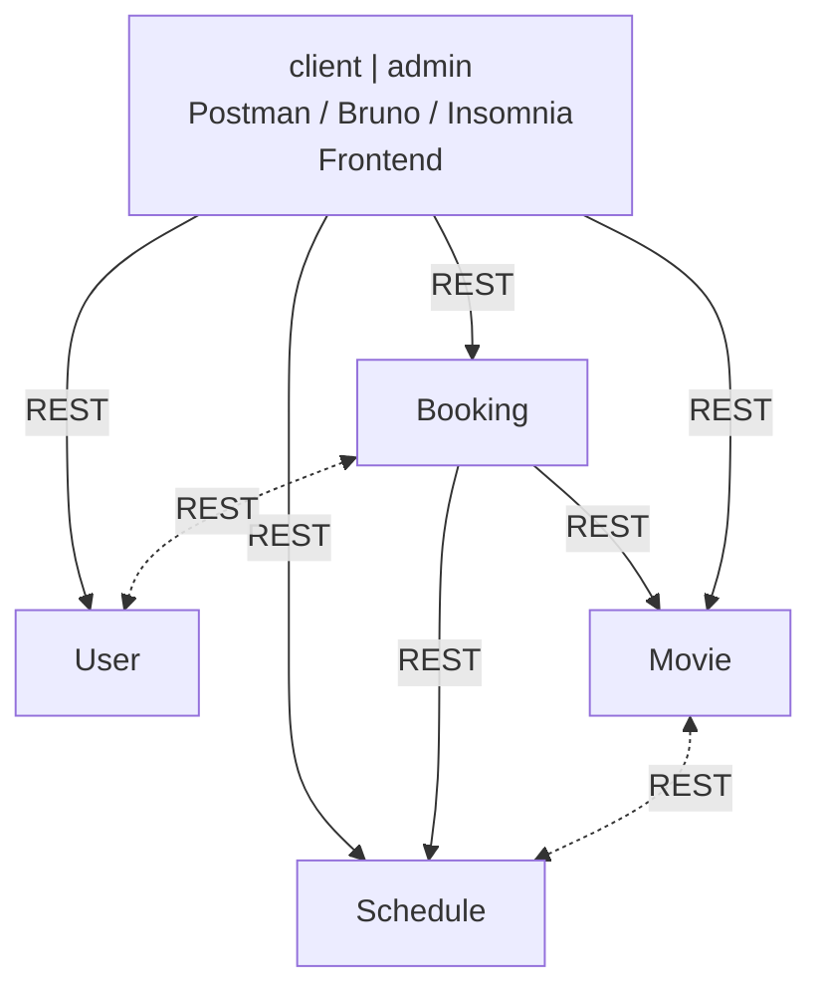

# UE-AD-A1-REST

Projet d'API REST en Flask réalisé pour l'UE Architectures distribuées, IMT Atlantique, FIL A1.

**Membres du groupe :** Lohan Boëglin, Rafaël Baudry

## Branches

- [`main`](https://github.com/lboeglin/UE-AD-A1-REST/tree/main) : présentation du dépôt
- [`rest`](https://github.com/lboeglin/UE-AD-A1-REST/tree/rest) : TP REST (cette branche)
- [`mixte`](https://github.com/lboeglin/UE-AD-A1-REST/tree/mixte) : TP MIXTE

## Consignes (TP REST)

Voir le [sujet du TP REST](https://helene-coullon.fr/pages/ue-ad-fil-25-26/tp-rest/).

## Services

| Service  | Port | Documentation |
|----------|------|---------------|
| Movie    | 3200 | `movie/movie.yaml` |
| Booking  | 3201 | `booking/booking.yaml` |
| Schedule | 3202 | `schedule/schedule.yaml` |
| User     | 3203 | `user/user.yaml` |

Lancement (un terminal par service) :

```bash
pip install -r requirements.txt
python movie/movie.py
python booking/booking.py
python schedule/schedule.py
python user/user.py
```

## Architecture



Par rapport au schéma d'origine, nous avons ajouté les flèches en pointillés :

- **Movie ↔ Schedule** : un film avec ses dates de diffusion (`GET /movies/<movieid>/times`), la suppression d'un film qui le retire aussi du programme (`DELETE /movies/<movieid>`, qui appelle `DELETE /movies/<movieid>/times` sur Schedule), et le programme d'une date avec le détail des films (`GET /times/<date>/movies`).
- **User ↔ Booking** : un utilisateur avec ses réservations détaillées (`GET /users/<user_id>/bookings`), et la liste des personnes ayant réservé un film (`GET /bookings/movie/<movieid>`).

## Authentification JWT

En plus des consignes, les services sont protégés par un token JWT (HS256).

1. On récupère un token auprès du service User :

   ```bash
   curl -X POST http://localhost:3203/login -H "Content-Type: application/json" -d '{"user_id": "rafael_baudry"}'
   ```

2. On l'envoie ensuite dans l'en-tête de chaque requête :

   ```
   Authorization: Bearer <token>
   ```

Le token contient l'identifiant (`sub`) et le rôle (`role`) de l'utilisateur. Il expire au bout d'une heure.

| Accès | Routes concernées |
|-------|-------------------|
| Libre | Consultation des films, des dates de diffusion et des utilisateurs |
| L'utilisateur concerné ou un admin | Ses réservations, la modification de son profil |
| Admin uniquement | Création, modification et suppression des films et des dates, gestion des utilisateurs et de leur rôle, liste de toutes les réservations |
