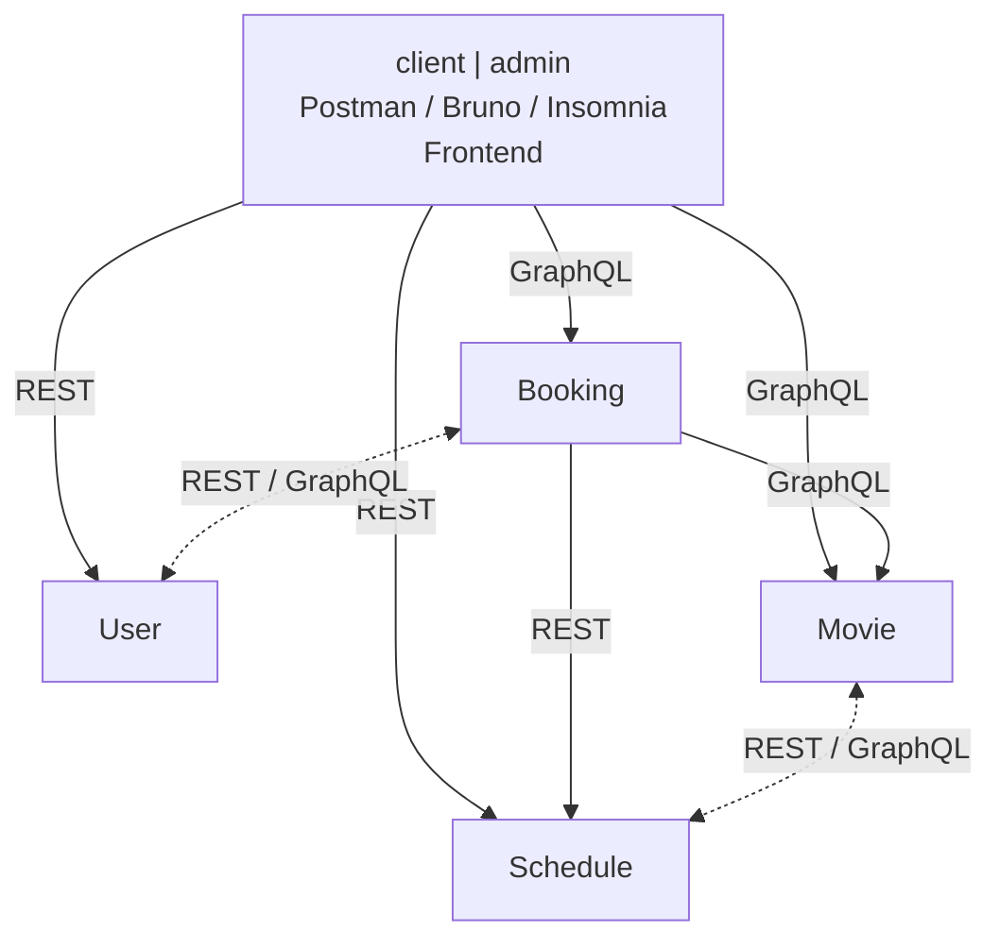

# UE-AD-A1-REST

Projet d'API REST en Flask réalisé pour l'UE Architectures distribuées, IMT Atlantique, FIL A1.

**Membres du groupe :** Lohan Boëglin, Rafaël Baudry

## Branches

- `rest` : TP REST
- `mixte` : TP mixte

## Consignes (TP REST)

Une application de cinéma découpée en 4 micro-services, chacun ayant sa propre base JSON :

- **Movie** : gère les films (CRUD).
- **Schedule** : gère les dates de diffusion des films (CRD, l'update n'est pas obligatoire).
- **Booking** : gère les réservations des utilisateurs (CRD). Il appelle Schedule pour vérifier qu'un film est bien programmé à la date réservée.
- **User** : gère les utilisateurs (CRUD).

Travail demandé :

1. Implémenter les opérations de chaque service de façon logique (par exemple, un non-admin ne voit pas les réservations des autres).
2. Coder deux ou trois points d'entrée supplémentaires qui recoupent des informations entre services. On peut ajouter des flèches entre les services si besoin.
3. Documenter chaque service en OpenAPI (fichiers `*.yaml`), avec des exemples et la description des entrées/sorties.

Les appels entre services se font avec le package `requests`.

## Services

| Service  | Port | Documentation |
|----------|------|---------------|
| Movie    | 3200 | `movie/movie.graphql` (GraphQL, `POST /graphql`) |
| Booking  | 3201 | `booking/booking.graphql` (GraphQL, `POST /graphql`) |
| Schedule | 3202 | `schedule/schedule.yaml` |
| User     | 3203 | `user/user.yaml` |

Lancement (un terminal par service) :

```bash
pip install -r requirements.txt
python movie/movie.py
python booking/booking.py
python schedule/schedule.py
python user/user.py
```

## Architecture



Par rapport au schéma d'origine, nous avons ajouté les flèches en pointillés :

- **Movie ↔ Schedule** : un film avec ses dates de diffusion (champ GraphQL `times` du type `Movie`, qui interroge Schedule en REST), et le programme d'une date avec le détail des films (`GET /times/<date>/movies`, qui interroge Movie en GraphQL).
- **User ↔ Booking** : un utilisateur avec ses réservations détaillées (`GET /users/<user_id>/bookings`, qui interroge Booking en GraphQL), et la liste des personnes ayant réservé un film (requête GraphQL `bookings_for_movie` sur Booking).
